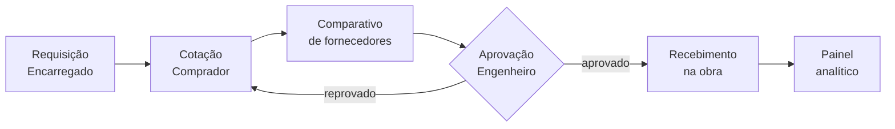

<div align="center">

<picture>
  <source media="(prefers-color-scheme: dark)" srcset="docs/branding/logo-dark.png">
  
</picture>

### Vizze Compras

Gestão do fluxo de compras de obra: da requisição à nota fiscal, numa única fila.

[](package.json)
[](tsconfig.json)
[](package.json)
[](server/db/schema.ts)
[](Dockerfile)
[](#)

</div>

---

## O que é

A Vizze Compras é o sistema interno da **Vizze Arquitetura e Construção** para acompanhar o processo de compra de material de obra do início ao fim: o encarregado pede, o comprador cota com fornecedores, o engenheiro aprova, e a obra recebe. Com histórico, justificativas e um painel que mostra onde o processo está travando.

Nasceu pra resolver um problema concreto: requisições em papel ou WhatsApp, cotações em planilhas soltas e nenhum jeito de saber, depois, "por que esse orçamento demorou tanto". Tudo isso agora mora em um único lugar, com uma trilha de auditoria de verdade.

## O fluxo



Cada seta é um evento registrado: quem fez, quando, e — em reprovações e exclusões de item já salvo — por quê.

## Funcionalidades

| Área | O que faz |
|---|---|
| **Requisição** | Encarregado monta a lista de itens da obra; rascunho persiste de verdade, nunca se perde |
| **Leitura por IA** | Cotação de fornecedor em PDF/foto é lida automaticamente (Gemini) e casada com os itens da requisição por similaridade de texto, sem criar duplicata |
| **Comparativo** | Lado a lado, por fornecedor e por item, pra decidir rápido |
| **Aprovação** | Engenheiro aprova ou reprova com justificativa; reprovado volta com os itens marcados pra revisão |
| **Recebimento** | Registro de nota fiscal por entrega, inclusive parcial |
| **Painel analítico** | Tempo médio por etapa, maior desvio, maior atraso — pra achar o gargalo real |
| **Usuários e obras** | Master cadastra, edita e redefine senha de qualquer usuário; Encarregado só enxerga as obras em que foi alocado |

## Perfis de acesso

| Perfil | Pode |
|---|---|
| **Master** | Tudo, incluindo gerenciar usuários e ver o painel |
| **Engenheiro** | Aprovar/reprovar orçamentos, ver o painel |
| **Comprador** | Montar requisição, cotar, comparar, dar recebimento |
| **Encarregado** | Requisitar e receber material, só nas obras em que está alocado |

## Stack

- **Front-end** — React 18 + Vite + TypeScript `strict`, Tailwind CSS, React Router
- **Back-end** — Node + Express, rodando com `tsx` (sem etapa de build do servidor)
- **Banco** — Postgres (Supabase) via Drizzle ORM, migrações versionadas
- **Autenticação** — bcrypt (hash de senha) + sessão em cookie `httpOnly` assinado (JWT) — nunca senha em texto puro, nunca sessão só no navegador
- **IA** — Google Gemini, pra leitura de cotações enviadas como documento/foto
- **Deploy** — Docker multi-stage, pronto para Coolify ou qualquer VPS com Docker Compose

## Rodando localmente

Pré-requisitos: Node 20+, um banco Postgres (Supabase ou local).

```bash
npm install
cp .env.example .env   # preencher DATABASE_URL, SESSION_SECRET, GEMINI_API_KEY
npm run db:migrate
npm run dev             # servidor em :3000, cliente em :5173 (proxy pro servidor)
```

No primeiro boot, se `MASTER_USUARIO`/`MASTER_SENHA` estiverem no `.env`, o usuário Master inicial é criado sozinho. Fora de produção, o banco também é populado com dados de demonstração quando está vazio.

## Variáveis de ambiente

| Variável | Obrigatória | Para quê |
|---|---|---|
| `DATABASE_URL` | sim | Conexão com o Postgres |
| `SESSION_SECRET` | sim | Assina o cookie de sessão (JWT) |
| `GEMINI_API_KEY` | sim | Leitura automática de cotações |
| `MASTER_USUARIO` / `MASTER_SENHA` | só no primeiro boot | Cria o usuário Master inicial |
| `PORT` | não (padrão 3000) | Porta do servidor |

Detalhes de cada uma em [`VARIAVEIS-DE-AMBIENTE-VPS.md`](VARIAVEIS-DE-AMBIENTE-VPS.md).

## Deploy

```bash
docker compose up -d --build
```

Builda a imagem (multi-stage — o `dist/` do Vite é gerado e o código fonte do cliente descartado), roda as migrações e o seed do Master automaticamente no boot. Passo a passo completo, incluindo a opção via Coolify, em [`DEPLOY.md`](DEPLOY.md).

## Estrutura do projeto

```
src/
  components/ui/     componentes e design system compartilhados
  features/          uma pasta por sistema (identidade, cadastros,
                      requisição/cotação, orçamento, painel)
  lib/                stores locais-com-sincronização, autenticação, utilitários
server/
  routes/             API REST
  db/                 schema, migrações e seed (Drizzle)
docs/
  decisoes.md         diário de decisões de arquitetura e produto
  SNS.md              numeração dos sistemas do app
```

Cada arquivo carrega um cabeçalho indicando a qual sistema pertence e por que existe — ver `docs/decisoes.md` para o histórico completo de decisões, inclusive as descartadas.

---

<div align="center">
<sub>Feito para a Vizze Arquitetura e Construção · uso interno</sub>
</div>
